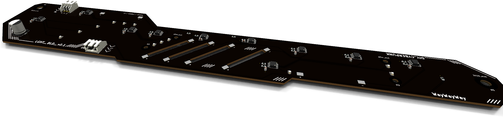
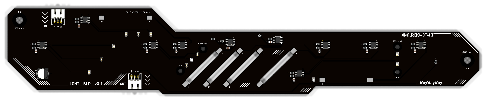
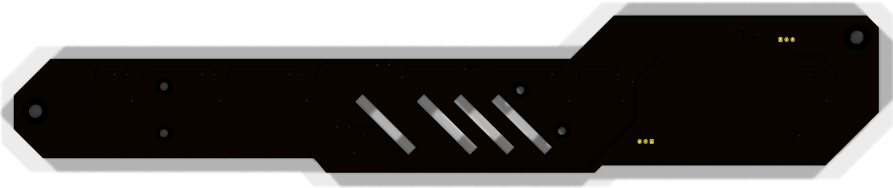

<div align="center">

```
 ██╗     ██╗ ██████╗ ██╗  ██╗████████╗    ██████╗ ██╗      █████╗ ██████╗ ███████╗
 ██║     ██║██╔════╝ ██║  ██║╚══██╔══╝    ██╔══██╗██║     ██╔══██╗██╔══██╗██╔════╝
 ██║     ██║██║  ███╗███████║   ██║       ██████╔╝██║     ███████║██║  ██║█████╗
 ██║     ██║██║   ██║██╔══██║   ██║       ██╔══██╗██║     ██╔══██║██║  ██║██╔══╝
 ███████╗██║╚██████╔╝██║  ██║   ██║       ██████╔╝███████╗██║  ██║██████╔╝███████╗
 ╚══════╝╚═╝ ╚═════╝ ╚═╝  ╚═╝   ╚═╝       ╚═════╝ ╚══════╝╚═╝  ╚═╝╚═════╝ ╚══════╝
          >>  DIY_CYBERPUNK  //  LGHT_BLD  //  WS2811 PIXEL SWORD  <<
```




*A 356 mm, sword-shaped, daisy-chainable LED board. It plugs into a WLED / Elite 4D-EXMU controller like an ordinary pixel strip.*

</div>

---

## `> SYS.INFO`

Each blade carries **12 small 0805 LEDs** and **6 glowing 38 mm LED filaments**. Ten **WS2811** driver chips control them, so the controller sees each blade as **10 standard RGB pixels**. Chain as many blades as your power supply can feed: data comes in on `IN` and goes out on `OUT`, one blade after another.

| `PARAM`        | `VALUE`                                                     |
|----------------|-------------------------------------------------------------|
| Outline        | 356 × 65 mm sword: hilt, 45° guard, slotted blade, bevelled tip |
| Stackup        | 2 layers, 1.6 mm, black soldermask, white silkscreen        |
| Drivers        | 10 × Worldsemi WS2811 (SOP-8), constant-current 18.5 mA outputs |
| Light          | 12 × 0805 white LEDs + 6 × 3 V / 38 mm filaments            |
| Protocol       | WS281x single wire, 800 kHz (SET pin left floating)         |
| Supply         | 5 V, ≈ 0.58 A per blade at full white                       |
| I/O            | 2 × JST XH 3-pin, right-angle (`IN` / `OUT`)                |
| Mounting       | 2 × M5 (2020 extrusion) + 4 × M3 (diffuser), copper-free keepouts |

---

## `> VISUAL.FEED`

<div align="center">

**`[ TOP ]`**


**`[ BOTTOM ]`**: solid GND plane, with the data chain hopping along it


</div>

---

## `> PIXEL.MAP`

Data flows chip to chip in this order. Each WS2811 is one pixel in WLED.


| Pixel | Chip | Drives | How to light it |
|:-----:|:----:|--------|-----------------|
| 1 | U1 | D1 · D2 · D3 on R · G · B | each channel is one LED |
| 2 | U2 | D4 · D5 · D6 | ″ |
| 3 | U3 | D7 · D8 · D9 | ″ |
| 4 | U4 | D10 · D17 · D18 | ″ |
| 5–10 | U5–U10 | filaments D11–D16, one per chip | **use white / grey (R = G = B)** |

> [!TIP]
> On the filament pixels all three outputs are tied together, giving about 55 mA per filament. The channels add up, so the brightness follows R + G + B. Colour values do nothing there; only the total level matters.

---

## `> JACK.IN`

```
        ┌──────────────┐
  pin 1 │  ■  +5V      │   silkscreen: 5V
  pin 2 │  ●  DATA     │   silkscreen: D
  pin 3 │  ●  GND      │   silkscreen: G
        └──────────────┘   same pinout on IN and OUT
```

- **Blade to blade:** JST XH 3-pin cable, female–female, straight through (pin 1 to pin 1).
- **Controller to first blade:** JST XH 3-pin pigtail. The bare wires go into the controller's screw terminals.

> [!WARNING]
> **There is no reverse-polarity protection.** A "reversed" XH cable swaps +5V and GND and kills the WS2811s and the bulk cap. Check every cable pin 1 to pin 1 with a multimeter before first power-up.

---

## `> POWER.GRID`

| Load | Current |
|------|--------:|
| 12 × 0805 LED × 18.5 mA | ≈ 222 mA |
| 6 × filament × ~55 mA | ≈ 330 mA |
| 10 × WS2811 quiescent | ≈ 30 mA |
| **Per blade, full white** | **≈ 0.58 A** |

The XH contacts are rated 3 A, so one feed powers about **5 blades**. For longer chains, inject 5 V partway along. Every chip gets its own 100 Ω + 100 nF filter on VDD, and each DIN has a 33 Ω series resistor against reflections and hot-plug spikes.

> [!NOTE]
> The WS2811 data input needs about 3.5 V (0.7 × VDD). If your controller outputs 3.3 V logic without a level shifter, the first blade may flicker.

---

## `> FAB.PIPELINE`

Assembly is done by **PCBWay**. You hand-solder the filaments yourself.

1. **Latest production set:** [`light_blade/pcbway_production/2026-10-18-12-11-58/`](light_blade/pcbway_production/2026-10-18-12-11-58/)

   | File | What it is |
   |------|------------|
   | `light_blade.kicad_pcb_gerber.zip` | Gerbers + drill files |
   | `light_blade_BOM_PCBWay.xlsx` | BOM rev 3 in PCBWay's template, with full manufacturer part numbers |
   | `light_blade_positions.csv` | Pick-and-place file, unique designators |
   | `light_blade.kicad_pcb_netlist.ipc` | IPC-356 netlist for electrical test |

2. **The filaments are not assembled by PCBWay.** D11–D16 are left out of the BOM and the positions file, and their pads stay empty. Solder them after delivery. Pad 1 is − (cathode) and pad 2 is + (anode), as marked on the silkscreen.

3. **To regenerate the outputs,** open `light_blade.kicad_pcb` in KiCad and run **PCBWay Fabrication Toolkit** from the plugin toolbar.

### Bill of materials

| Ref | Qty | Part | Mfr · MPN |
|-----|:---:|------|-----------|
| U1–U10 | 10 | LED driver, SOP-8 | Worldsemi · `WS2811` |
| D1–D10, D17, D18 | 12 | LED white 0805 | KENTO · `KT-0805W` |
| C1–C10 | 10 | 100 nF X7R 50 V 0805 | Samsung · `CL21B104KBCNNNC` |
| C11 | 1 | 470 µF 10 V electrolytic, 8 × 10.2 mm | Panasonic · `EEE-FK1A471P` |
| R1–R10, R21 | 11 | 33 Ω 1 % 0805 | YAGEO · `RC0805FR-0733RL` |
| R11–R20 | 10 | 100 Ω 1 % 0805 | YAGEO · `RC0805FR-07100RL` |
| J1, J2 | 2 | JST XH 3P right-angle | JST · `S3B-XH-A(LF)(SN)` |
| D11–D16 | 6 | LED filament 3 V 38 mm | *hand-soldered, not in the BOM* |

---

## `> FILE.TREE`

```
.
├── light_blade/
│   ├── light_blade.kicad_pro         ← open this in KiCad 10
│   ├── light_blade.kicad_sch         ← schematic
│   ├── light_blade.kicad_pcb         ← layout
│   ├── light_blade.pretty/           ← custom LED_Filament_38mm footprint
│   ├── fab_gerber/                   ← plain KiCad gerber export
│   └── pcbway_production/            ← timestamped PCBWay order packages
├── docs/                             ← renders used in this README
├── light_blade_plan_v1.md            ← design notes & decisions
└── Sample_BOM_PCBWay.xlsx            ← PCBWay's BOM template
```

---

## `> STATUS`

- [x] Schematic + layout, DRC clean
- [x] BOM with full MPNs, unique designators
- [x] Copper keepouts at mounting holes, tight decoupling on every chip
- [ ] PCBWay order: rev 3 files ready to send
- [ ] Measure the real filaments: tab spacing (footprint pitch is 36 mm), polarity and current
- [ ] Confirm the controller's data voltage on the chosen port
- [ ] First light 🔥

---

<div align="center">

```
 ░▒▓█  WAKE UP. THE CITY NEEDS MORE LIGHT.  █▓▒░
```

<sub>Designed in KiCad · assembled by PCBWay · lit by WS2811</sub>

</div>
